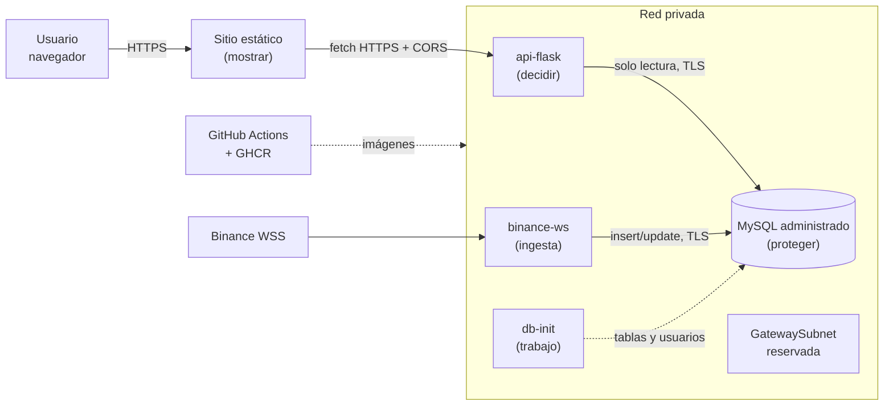

# SecureChain · Plataforma nube nativa de datos de mercado

> **"Cada capa existe por una razón: mostrar, decidir y proteger."**

Equipo: Tomás Felipe Ramírez Moreno · Josué Alejandro Fernández Ortiz · Jorge Andrés Ramírez Sánchez

Sitio en vivo (Azure, Spain Central): https://stsecurechainss5xxyqm.z43.web.core.windows.net
API: https://api-flask.orangesea-46fe8cd0.spaincentral.azurecontainerapps.io/api/precios

---

## 1. Caso de negocio

### El cliente y su problema

**SecureChain** es una empresa colombiana que certifica la confianza en la tokenización de activos. Su idea central es que el problema no es el miedo a la tecnología, sino **el costo oculto de no usarla**. El sistema financiero tradicional cobra comisiones por cada intermediación, tarda días en reflejar un movimiento y deja por fuera a quien no tiene historial crediticio. La tokenización ofrece inmediatez, trazabilidad y costos cercanos a cero, pero el ciudadano no confía en que ese "nuevo sistema" sea distinto. Los esquemas fraudulentos que usan el vocabulario de moda refuerzan esa desconfianza.

SecureChain no vende tecnología: vende **justicia financiera**. Su propuesta de valor es el **Sello de Confianza**:

| Para quién | Qué recibe |
| --- | --- |
| Usuario final (retail) | Educación ("Yo entiendo mi dinero digital") y una forma simple de saber qué entidades son confiables |
| Exchanges y brokers que llegan a Colombia | Un sello de calidad y seguridad basado en ISO 27001 y alineado con la regulación local, que acelera su due diligence |
| Comercios aliados | Respaldo verificable para aceptar y ofrecer activos digitales |

### Qué necesitaba el cliente de esta plataforma

Un sello solo genera confianza si se apoya en datos verificables. El **Trust Center** de SecureChain necesita mostrar en vivo precios del mercado, historial e incidentes de seguridad (hacks y exploits), para que usuarios y auditores puedan comparar lo que promete una plataforma con lo que ocurre en el mercado. Los requisitos eran:

1. **Ingesta continua** de datos de mercado desde fuentes externas (exchanges y agregadores).
2. **Seguridad por capas:** los datos no pueden quedar expuestos a Internet; cada componente accede solo a lo que necesita.
3. **Portabilidad:** la cuenta de Azure anterior se quedó sin créditos y hubo que reconstruir todo. La solución no podía volver a depender de una sola cuenta ni de un solo proveedor.
4. **Uso eficiente del crédito** mientras el proyecto se presenta y se aprueba.

---

## 2. Trabajo realizado

| Etapa | Resultado |
| --- | --- |
| Prototipo inicial | Arquitectura de 3 capas en 2 VMs de Azure (IIS + Flask/MySQL), con VNet peering y NSG. Se validó el aislamiento con el experimento "Failed to fetch". |
| Rediseño nube nativa | Las 3 capas se mantienen, pero sin VMs: sitio estático, contenedores y base de datos administrada. Se eliminaron IIS, IPs públicas, peering y administración por RDP/SSH. |
| Microservicios | `binance-ws` (ingesta en tiempo real), `api-flask` (API de solo lectura), `db-init` (preparación de la base), sobre una librería común. |
| Calidad | 34 pruebas automáticas: Binance simulado (cortes, silencio, bloqueo 451, datos fuera de orden), API, y MySQL real con verificación de permisos mínimos. |
| CI/CD | GitHub Actions corre las pruebas contra MySQL 8.4 y publica las 3 imágenes en GitHub Container Registry en cada cambio a `main`. |
| Despliegue | Infraestructura como código (`deploy/desplegar.sh` + plantillas YAML) en Azure Container Apps, región Spain Central. |
| Verificación | Ingesta real de Binance escribiendo en MySQL privado; la API y el sitio muestran precios en vivo. |
| Operación eficiente | Modo ahorro (`deploy/ahorro.sh`): la ingesta se apaga entre presentaciones, la API escala a cero y hay alertas al 50, 80 y 100 % del crédito. |

### Hallazgos técnicos que cambiaron el diseño

- **Binance bloquea servidores en EE. UU.** (HTTP 451). Por eso la ingesta corre en Europa (Azure Spain Central o AWS `eu-south-2`) y el código explica ese error en sus logs.
- **Una conexión de Binance dura máximo 24 h.** El servicio se reconecta solo cada 23 h y cuando pasan 60 s sin datos.
- **Azure for Students limita las regiones** (Brazil South, Mexico Central, Canada Central, Spain Central y Chile Central). Se eligió Spain Central y se verificó que desde ahí Binance entrega datos.

---

## 3. Arquitectura



| Capa | Servicio | En Azure (desplegado) |
| --- | --- | --- |
| Mostrar | `web/` | Storage Account con sitio estático |
| Decidir | `api-flask` | Container Apps, HTTPS, CORS solo para el sitio, de 0 a 2 réplicas |
| Proteger | MySQL | Azure Database for MySQL Flexible Server, sin IP pública, TLS verificado |
| Ingesta | `binance-ws` | Container Apps, 1 réplica (0 en modo ahorro) |
| Preparación | `db-init` | Trabajo de Container Apps a pedido |
| Red | VNet 10.10.0.0/16 | `snet-apps`, `snet-mysql` y `GatewaySubnet` (reservada para VPN o ExpressRoute) |

**Seguridad por capas:** cada servicio usa su propio usuario de MySQL con el mínimo de permisos (`ingesta`: SELECT, INSERT, UPDATE; `api_lectura`: solo SELECT). Las claves son secretos de la plataforma, nunca están en el código. Todo el tráfico va cifrado.

---

## 4. Los principios nube nativa aplicados

Siguiendo la definición de la [CNCF](https://architecture.cncf.io/) y de [AWS](https://aws.amazon.com/what-is/cloud-native/): sistemas débilmente acoplados, independientes del proveedor y optimizados en costo, seguridad y rendimiento.

| Principio | Cómo se cumple en SecureChain |
| --- | --- |
| Microservicios | Un servicio por responsabilidad (`binance-ws`, `api-flask`, `db-init`), que se comunican por la base de datos y por una API HTTP. Si la ingesta se cae, la API sigue respondiendo. |
| Contenedores y orquestación | Una imagen Docker por servicio, ejecutada por un orquestador administrado (Container Apps, que usa Kubernetes por debajo). Las mismas imágenes corren en AWS ECS/EKS o en cualquier Kubernetes. |
| DevOps y CI/CD | Cada push corre las pruebas y publica las imágenes sin intervención manual. El despliegue es un script versionado, no clics en un portal. |
| Serverless | La API y los trabajos escalan a cero y solo consumen mientras atienden. La siguiente fuente (CoinGecko cada 5 min) está pensada como función programada (AWS Lambda + EventBridge o Azure Functions). |
| Resiliencia y escalabilidad | Reconexión con espera exponencial, sondas de salud que reinician contenedores colgados, escrituras idempotentes, lotes que no se pierden si cae MySQL y escalado automático de la API. |
| Independencia del proveedor | Código, imágenes y CI viven en GitHub. Cambiar de nube cambia la "plataforma", no la aplicación (ver sección 5). |

---

## 5. Portabilidad a AWS (escalabilidad)

La misma arquitectura, pieza por pieza. Las imágenes Docker y el código no cambian.

| Componente | Azure (hoy) | AWS (equivalente) |
| --- | --- | --- |
| Región | Spain Central | Europe (Spain) `eu-south-2`, con Fargate disponible ([AWS](https://docs.aws.amazon.com/AmazonECS/latest/developerguide/AWS_Fargate-Regions.html)) |
| Red privada | VNet + subredes privadas | VPC con subredes privadas en 2 zonas de disponibilidad |
| Sitio estático | Storage static website | Amazon S3 + CloudFront |
| Entrada HTTPS / CORS | Ingress de Container Apps | Application Load Balancer (o API Gateway) |
| `api-flask` | Container App de 0 a 2 réplicas | Servicio de ECS sobre Fargate con auto scaling |
| `binance-ws` | Container App de 1 réplica | Servicio de ECS sobre Fargate (desired count 1, o 0 en ahorro) |
| `db-init` | Trabajo de Container Apps | Tarea de ECS de un solo uso |
| `coingecko-job` (siguiente) | Trabajo programado | AWS Lambda + Amazon EventBridge Scheduler |
| MySQL | MySQL Flexible Server privado | Amazon RDS for MySQL en subredes privadas |
| Secretos | Secretos de Container Apps | AWS Secrets Manager |
| Logs | Log Analytics | Amazon CloudWatch Logs |
| Imágenes | GitHub Container Registry | GHCR o Amazon ECR |
| Alertas de crédito | Cost Management Budgets | AWS Budgets |
| Puerta para redes externas | `GatewaySubnet` | Virtual private gateway o Transit Gateway |

Para escalar, ECS/Fargate agrega tareas según la carga, RDS admite réplicas de lectura para la API y Lambda escala por evento. Si el tráfico lo justifica, Kubernetes administrado (EKS) toma el lugar de ECS con las mismas imágenes.

---

## 6. Conectividad: hoja de ruta

Basada en el whitepaper *Amazon VPC Connectivity Options*. La red se creó con una subred reservada para el gateway, así que cada etapa agrega una pieza sin rediseñar.

| Etapa | Arquitectura | Cuándo |
| --- | --- | --- |
| 0 | Internet con HTTPS | Hoy: usuarios, comercios e ingesta |
| 1 | Site-to-Site VPN (p. 6) | El primer aliado pide un túnel privado |
| 2 | Transit Gateway + VPN (p. 7–8) | Varias redes o aliados a la vez |
| 3 | Direct Connect (p. 10) | Un aliado regulado con centro de datos propio: banco o exchange |
| 4 | Direct Connect + VPN (p. 13) | Lo mismo, con cifrado de punta a punta para datos de KYC |
| Holgura | Transit Gateway + SD-WAN (p. 16) | Cuando SecureChain tenga sedes y comercios en varias ciudades (fase de expansión del EDT). El PDF la recomienda para topologías con varias sedes; puede usar Direct Connect como transporte. |

En el **Direct Connect de la página 10**: la VPC con subredes privadas es la red de SecureChain; el *virtual private gateway* ocupa la subred reservada; el *private VIF* llega a la ubicación de Direct Connect; y el *customer gateway* es el router del aliado. Es una línea privada, pero no cifrada por defecto. Por eso la etapa 4 agrega una VPN encima.

---

## 7. Operación

### Desplegar desde cero (Azure Cloud Shell)

```bash
git clone https://github.com/tomasramirez20/securechain-ingesta.git && cd securechain-ingesta
bash deploy/desplegar.sh verificar             # suscripción y regiones permitidas
bash deploy/desplegar.sh preparar              # registra proveedores (una vez)
UBICACION=spaincentral bash deploy/desplegar.sh red
bash deploy/desplegar.sh mysql
bash deploy/desplegar.sh entorno
DUENO=tomasramirez20 bash deploy/desplegar.sh dbinit
bash deploy/desplegar.sh binance
bash deploy/desplegar.sh web
bash deploy/desplegar.sh api
bash deploy/desplegar.sh subir-web
bash deploy/desplegar.sh estado
```

### Modo ahorro y demostraciones

```bash
bash deploy/ahorro.sh alertas    # alertas de presupuesto al 50/80/100 % del crédito
bash deploy/ahorro.sh demo       # enciende la ingesta y espera precios en vivo (1 a 2 min)
bash deploy/ahorro.sh apagar     # vuelve a modo ahorro
bash deploy/ahorro.sh estado
```

### Probar en local

```bash
cp .env.example .env && docker compose up --build    # MySQL + db-init + binance-ws + api-flask
pip install -r requirements-dev.txt ./common && pytest -v
```

### API

| Ruta | Qué devuelve |
| --- | --- |
| `GET /api/precios` | Último precio de cada símbolo (`?fuente=` opcional) |
| `GET /api/precios/<simbolo>` | Un símbolo, por ejemplo `BTCUSDT` |
| `GET /api/historicos?activo=bitcoin&moneda=usd&intervalo=1d` | Serie histórica |
| `GET /api/incidentes` | Hacks y exploits recientes |
| `GET /api/eventos` | Mercados de predicción |
| `GET /healthz`, `GET /readyz` | Vida del proceso y conexión a MySQL |

---

## 8. Estructura del repositorio

```
common/ingesta_common/   config + TLS, logs JSON, backoff, /healthz, escritura en MySQL
services/binance-ws/     ingesta en tiempo real (WebSocket de Binance)
services/api-flask/      API JSON de solo lectura
services/db-init/        crea tablas y usuarios de permisos mínimos
db/schema.sql            precios, historicos, incidentes, eventos
web/                     frontend estático
deploy/                  despliegue (desplegar.sh), modo ahorro (ahorro.sh), plantillas
tests/                   34 pruebas
.github/workflows/       CI/CD
```

## 9. Siguientes pasos

1. `coingecko-job` como función serverless (históricos cada 5 min) y `polymarket-ws` con el mismo esqueleto de `binance-ws`.
2. Fuente de incidentes: el endpoint de hacks de DefiLlama es solo del plan Pro; hay que elegir una alternativa.
3. Despliegue piloto en AWS `eu-south-2` con la tabla de la sección 5.
4. Etapa 1 de conectividad cuando el primer aliado la solicite.

## Referencias

- [CNCF – Cloud Native Reference Architecture](https://architecture.cncf.io/)
- [AWS – What is Cloud Native?](https://aws.amazon.com/what-is/cloud-native/)
- [Microsoft – Defining cloud native](https://learn.microsoft.com/en-us/dotnet/architecture/cloud-native/definition)
- [Google Cloud – 5 principles for cloud-native architecture](https://cloud.google.com/blog/products/application-development/5-principles-for-cloud-native-architecture-what-it-is-and-how-to-master-it)
- [IBM – What is cloud native?](https://www.ibm.com/think/topics/cloud-native)
- AWS Whitepaper – *Amazon Virtual Private Cloud Connectivity Options* (Direct Connect p. 10, SD-WAN p. 16)
- [Binance – WebSocket Streams](https://github.com/binance/binance-spot-api-docs/blob/master/web-socket-streams.md)
